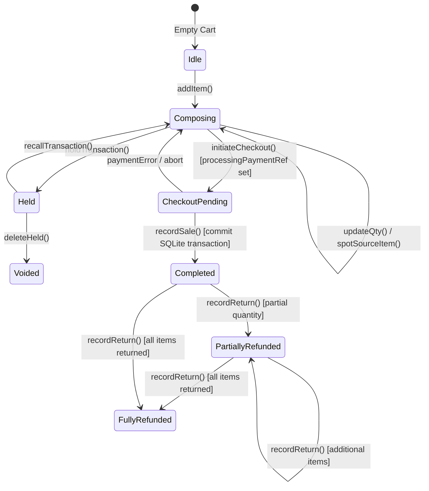

# State Machine 01: POS Cart & Sale Transaction Lifecycle

## 1. Domain Context & Entities
In DumosRx, point-of-sale transactions bridge ephemeral UI state, local SQLite tables, and downstream reporting (P&L, till drawer balances, stock depletion, and customer debt). The state machine governs the lifetime of a customer's basket from initial composition to multi-tender settlement, and subsequent partial or full return reconciliations.

Key entities:
- **In-Memory Cart**: [`use-pos-cart-store.ts`](file:///Users/admin/Documents/Projects/DumosRx/client/lib/hooks/use-pos-cart-store.ts)
- **Held Transactions**: `held_transactions` SQLite table ([`held-transactions.ts`](file:///Users/admin/Documents/Projects/DumosRx/client/lib/db/queries/held-transactions.ts))
- **Sales & Lines**: `sales`, `sale_items`, `sale_item_batches` ([`sales.ts`](file:///Users/admin/Documents/Projects/DumosRx/client/lib/db/queries/sales.ts))
- **Returns & Restorations**: `returns`, `return_items` ([`returns.ts`](file:///Users/admin/Documents/Projects/DumosRx/client/lib/db/queries/returns.ts))
- **Spot Sourcing Expenses**: `expenses` (category: `Spot Sourcing`)

---

## 2. Governing State Fields & Flags

### Ephemeral / In-Memory Flags (`cart[]` & POS Store)
- `processingPaymentRef`: Nonce/lock preventing double-charge submission during async checkout.
- `dispensedRxId`: Locks cart contents to an active prescription dispense.
- `cart[].is_spot_sourced`: Boolean flag routing line away from shelf inventory deduction.
- `cart[].sourcing_payment_source`: `'till_drawer'` | `'personal_account'`.
- `cart[].cost_price`, `cart[].original_unit_price`: Baseline cost and custom selling price overrides.
- `isResellerSale`, `resellerAgentId`, `markupType`: `'reseller'` vs `'store'`.

### Persisted Database Columns
- `sales.payment_status`: `'pending'` | `'partial'` | `'completed'` | `'refunded'` | `'partially_refunded'`.
- `sales.payment_method`: `'cash'` | `'card'` | `'transfer'` | `'credit'` | `'split'`.
- `sales.payment_details`: JSON string storing tender splits, spot-sourcing metadata, customer balance updates.
- `sales.reseller_commission_amount`, `sales.reseller_commission_owed_back`: Commission state.

---

## 3. State Transition Diagram



---

## 4. Transition Triggers & Code Paths

1. **`Idle -> Composing`**: Cashier scans barcode or selects item via [`use-pos-cart.ts`](file:///Users/admin/Documents/Projects/DumosRx/client/lib/hooks/use-pos-cart.ts). If `dispensedRxId` is present, product additions are locked.
2. **`Composing -> Held`**: Triggered by [`holdCurrentCart()`](file:///Users/admin/Documents/Projects/DumosRx/client/lib/hooks/use-pos-held-transactions.ts). Serializes cart lines, pricing overrides, prescription ID, customer ID, and reseller metadata into `held_transactions`.
3. **`Held -> Composing`**: Triggered by [`recallHeld()`](file:///Users/admin/Documents/Projects/DumosRx/client/lib/hooks/use-pos-held-transactions.ts). Restores cart state and atomic line properties (`is_spot_sourced`, `sourcing_payment_source`, custom price).
4. **`Composing -> CheckoutPending`**: User clicks "Charge" / "Complete Sale". `processingPaymentRef` is assigned to prevent duplicate submission while calculating multi-tender splits or verifying customer credit limit.
5. **`CheckoutPending -> Completed`**: [`recordSale()`](file:///Users/admin/Documents/Projects/DumosRx/client/lib/db/queries/sales.ts) executes inside an atomic SQLite transaction:
   - Inserts `sales`, `sale_items`, and `sale_item_batches`.
   - Depletes shelf inventory via `stock_movements` (movement_type: `'sale'`), **except** for lines where `is_spot_sourced = true`.
   - If spot-sourced items use `till_drawer`, writes an entry into `expenses` (`category = 'Spot Sourcing'`).
   - If credit is used, increments `customers.outstanding_balance`.
   - If `dispensedRxId` is set, marks `prescriptions.status = 'completed'` and sets `dispensed_at = NOW()`.
6. **`Completed -> PartiallyRefunded / FullyRefunded`**: Triggered via [`restoreReturnedStock()`](file:///Users/admin/Documents/Projects/DumosRx/client/lib/db/queries/returns.ts):
   - Computes already-restored quantities per batch via `getAlreadyRestoredByBatch()`.
   - Restores physical shelf batches based on recorded `sale_item_batches` (FEFO proportions).
   - If sale was credit, reduces customer debt; if cash/card, refunds cash drawer.
   - Computes prorated reseller commission clawback (`reseller_commission_owed_back`).

---

## 5. Invariants & Illegal States

- **Invariant 1: Shelf Batch Isolation for Spot-Sourced Lines**: A line with `is_spot_sourced = true` must NEVER generate a `stock_movements` entry or deplete `stock_batches`. Violating this creates phantom negative batch quantities.
- **Invariant 2: P&L Operating Expense Isolation**: Spot-sourcing expenses must deduct from cash drawer balances during evening till counts, but must NEVER be categorized as business operating expenses in P&L reports (cost is already captured in COGS).
- **Invariant 3: Single Active Prescription Lock**: A cart cannot mix items from two different prescriptions, nor can a dispensed prescription cart have items added/removed after dispense lock.
- **Invariant 4: Return Restore Cap**: Total units restored across multiple partial returns cannot exceed `sale_items.quantity`.
- **Impossible State**: `sales.payment_status = 'refunded'` while `SUM(return_items.quantity) == 0`.

---

## 6. Latent Edge-Case Bugs & Traps

1. **Double Submission via Keyboard & Touch**: If the user double-clicks the checkout button, network or SQLite latency can queue two `recordSale()` executions. Mitigated by `processingPaymentRef` ref-guard.
2. **Partial Return Batch Over-Restoration**: Without `getAlreadyRestoredByBatch()`, if a customer returns 1 unit of a 3-unit split-batch sale, and later returns the second unit, naive restore would re-credit the first batch twice.
3. **Credit Limit Race**: Two registers checking out the same customer with credit limits concurrently can both pass `balance + amount <= credit_limit` before either commits.

---

## 7. Diagnostic Queries & State Verification

```sql
-- Check for orphan returns or over-restored quantities
SELECT r.id, r.sale_id, ri.product_id, ri.quantity as returned_qty, si.quantity as sold_qty
FROM return_items ri
JOIN returns r ON r.id = ri.return_id
JOIN sale_items si ON si.sale_id = r.sale_id AND si.product_id = ri.product_id
WHERE ri.quantity > si.quantity;

-- Check for spot-sourced items that erroneously created stock movements
SELECT sm.id, sm.product_id, sm.quantity, sm.reference_id
FROM stock_movements sm
JOIN sales s ON s.id = sm.reference_id
WHERE sm.movement_type = 'sale'
  AND json_extract(s.payment_details, '$.spot_sourcing') IS NOT NULL
  AND sm.stock_batch_id IS NULL;
```
