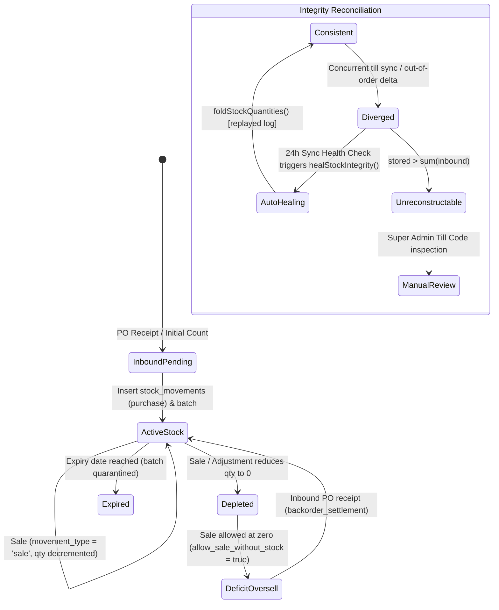

# State Machine 02: Inventory Stock Batches, Oversell & Auto-Heal

## 1. Domain Context & Entities
In DumosRx, inventory quantity is an event-sourced ledger model wrapped in a high-performance cached column:
- **`stock_movements`** is the append-only source of truth.
- **`stock_batches.quantity`** is an operational cache rebuilt or adjusted according to strict mathematical rules.
- **Auto-Heal Engine** ([`stock-auto-heal.ts`](file:///Users/admin/Documents/Projects/DumosRx/client/lib/db/sync-engine/stock-auto-heal.ts)) detects and repairs drift between the cached batch quantity and the replayed ledger.

Key entities:
- **Batches**: `stock_batches` ([`batch-quantity.ts`](file:///Users/admin/Documents/Projects/DumosRx/client/lib/db/batch-quantity.ts))
- **Movement Ledger**: `stock_movements` ([`inventory-sale-stock.ts`](file:///Users/admin/Documents/Projects/DumosRx/client/lib/db/queries/inventory-sale-stock.ts))
- **Pending Out-of-Order Deltas**: `_pending_stock_deltas` ([`deferred-stock-deltas.ts`](file:///Users/admin/Documents/Projects/DumosRx/client/lib/db/sync-engine/deferred-stock-deltas.ts))
- **Integrity Verifier**: [`stock-integrity.ts`](file:///Users/admin/Documents/Projects/DumosRx/client/lib/db/sync-engine/stock-integrity.ts)
- **Backorders**: [`backorders.ts`](file:///Users/admin/Documents/Projects/DumosRx/client/lib/db/queries/backorders.ts)

---

## 2. Governing State Fields & Enums

### Batch Status & Veracity
- `stock_batches.quantity`: Cached on-hand units.
- `stock_batches.is_active`: `1` (selectable in POS) | `0` (archived/depleted).
- `stock_batches.expiry_date`: Governs FEFO order (`ORDER BY expiry_date ASC, created_at ASC`).
- `movement_type`: `'purchase'` | `'sale'` | `'adjustment'` | `'return'` | `'expired'` | `'damaged'` | `'bulk_import'`.

### Integrity Classification (`BatchVerdict`)
- **`consistent`**: `stock_batches.quantity == MAX(0, SUM(movements))`.
- **`diverged`**: Stored quantity disagrees with movement log; reconstructable.
- **`pending`**: Disagrees, but has unapplied rows in `_pending_stock_deltas`.
- **`unreconstructable`**: `stored_quantity > SUM(inbound_movements)`. Rebuilding from log would delete untracked inventory (A-148 carve-out).

---

## 3. State Transition Diagram



---

## 4. Transition Triggers & Code Paths

1. **`Inbound -> ActiveStock`**: Receipt of PO items or manual stock adjustment inserts positive `stock_movements` and calls `recomputeBatchQuantities()`.
2. **`ActiveStock -> Depleted / Deficit`**: POS checkout in [`depleteShelfStock()`](file:///Users/admin/Documents/Projects/DumosRx/client/lib/db/queries/inventory-sale-stock.ts).
   - If store allows selling at zero (`allow_sale_without_stock = true`), batch quantity can drop to `0` and record shortfall as an owed backorder.
   - Movements record negative quantity.
3. **`Deferred Delta Arrives`**: In sync pull, if a `stock_movements` arrives before its `stock_batches` row exists locally, it enters `_pending_stock_deltas`.
   - On every pull round end, [`applyDeferredStockDeltas()`](file:///Users/admin/Documents/Projects/DumosRx/client/lib/db/sync-engine/deferred-stock-deltas.ts) polls `_pending_stock_deltas`.
   - Once batch arrives, delta is applied via `recomputeBatchQuantities()` and discarded from `_pending_stock_deltas`.
4. **`Auto-Heal Execution`**: Daily sync health check calls [`healStockIntegrity()`](file:///Users/admin/Documents/Projects/DumosRx/client/lib/db/sync-engine/stock-auto-heal.ts):
   - **Gated by**: `movementLogIsComplete()` (must have finished pull with no active cursor) and `!isTillInspectionSession()`.
   - Classifies every active batch.
   - Replays `onHandFromLog(deltas)` and updates `stock_batches.quantity` for `diverged` rows.
   - Refuses to touch `unreconstructable` rows to prevent inventory loss.

---

## 5. Invariants & Illegal States

- **Invariant 1: Floor over Sum**: `onHandFromLog()` computes `Math.max(0, SUM(deltas))`. Outbound movements must NEVER calculate negative intermediate balances that clamp individually to zero before later additions (the single-floor rule).
- **Invariant 2: Carve-Out Rule (A-148)**: If `stored > inboundBefore`, the batch holds unlogged units (e.g. from legacy migration). Auto-heal must NEVER reset quantity to replayed total; it must patch by net delta (`stored + delta`).
- **Invariant 3: Pending Delta Isolation**: Never fold a diverged batch if it has rows waiting in `_pending_stock_deltas`. Folding prematurely causes double-counting when the pending delta finally executes.
- **Impossible State**: A batch marked `is_active = 1` with negative `quantity` in `stock_batches` (the cache clamps to 0; negative state is recorded in movement deficit logs, not batch table).

---

## 6. Latent Edge-Case Bugs & Traps

1. **Clock Desync Skipping Pull Deltas**: Server MySQL runs on EDT while Laravel writes UTC (Rule 7). Raw DB timestamp edits in the past cause sync pull to skip movement rows, resulting in `diverged` verdicts that auto-heal cannot resolve until movement log catches up.
2. **Out-of-Order PO Receipt vs Sale**: Device A sells stock received 5 minutes earlier on Device B. If Device A syncs before Device B's PO batch arrives, Device A generates a negative deficit or pending delta.
3. **Unreconstructable Phantom Refusal**: If a product import was done with direct batch insertion without an initial `bulk_import` movement row, the batch is permanently flagged `unreconstructable` and auto-heal will refuse to touch it.

---

## 7. Diagnostic Queries & Recovery Commands

```sql
-- Find batches where cached quantity diverges from movement ledger
SELECT sb.id, sb.product_id, sb.quantity AS cached_qty,
       COALESCE(SUM(sm.quantity), 0) AS ledger_qty,
       (sb.quantity - COALESCE(SUM(sm.quantity), 0)) AS unit_drift
FROM stock_batches sb
LEFT JOIN stock_movements sm ON sm.stock_batch_id = sb.id AND sm._deleted = 0
WHERE sb._deleted = 0 AND sb.is_active = 1
GROUP BY sb.id
HAVING cached_qty != MAX(0, ledger_qty);

-- Batches in deficit (more sold than ever recorded received)
SELECT sm.stock_batch_id, p.name, SUM(sm.quantity) AS net_balance
FROM stock_movements sm
JOIN products p ON p.id = sm.product_id
WHERE sm._deleted = 0
GROUP BY sm.stock_batch_id
HAVING net_balance < 0;
```
