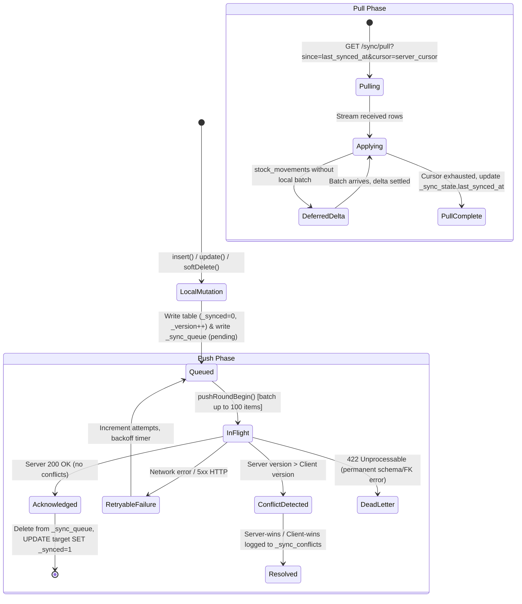

# State Machine 03: Offline-First Sync Engine & Queue Lifecycle

## 1. Domain Context & Entities
DumosRx operates offline-first on client devices (SQLite) syncing bidirectionally with a central cloud API (Laravel / MySQL). The sync engine guarantees local read/write responsiveness without network, resilient recovery after weeks of offline operation, and automated conflict arbitration.

Key entities:
- **Local Outbox Queue**: `_sync_queue` ([`push-queue-prep.ts`](file:///Users/admin/Documents/Projects/DumosRx/client/lib/db/sync-engine/push-queue-prep.ts))
- **Sync Watermarks**: `_sync_state` ([`pull-state.ts`](file:///Users/admin/Documents/Projects/DumosRx/client/lib/db/sync-engine/pull-state.ts))
- **Conflict Ledger**: `_sync_conflicts` ([`conflict-log.ts`](file:///Users/admin/Documents/Projects/DumosRx/client/lib/db/sync-engine/conflict-log.ts))
- **Operator Commands**: `_pending_command_results` ([`sync-commands.ts`](file:///Users/admin/Documents/Projects/DumosRx/client/lib/db/sync-engine/sync-commands.ts))
- **Server Handlers**: `SyncController.php`, `PushService.php`, `PullService.php`

---

## 2. Governing State Fields & Columns

### Queue Row Lifecycle (`_sync_queue`)
- `status`: `'pending'` | `'in_flight'` | `'failed'` | `'dead_letter'`.
- `action`: `'insert'` | `'update'` | `'delete'`.
- `attempts`: Integer retry count.
- `last_error`: Text message from server rejection.

### Row-Level Tracking (Every Synced Table)
- `_synced`: `0` (locally modified, unacknowledged) | `1` (clean, matches server).
- `_version`: Monotonically increasing local revision counter.
- `_synced_at`: ISO timestamp of last server acknowledgment.
- `_deleted`: Soft-delete tombstone (`1` = tombstoned, `0` = active).

### Operator Command Execution (`_pending_command_results`)
- `status`: `'applied'` | `'failed'` | `'refused'`.

---

## 3. State Transition Diagram



---

## 4. Transition Triggers & Code Paths

1. **`LocalMutation -> Queued`**: The local database abstraction ([`local-database.ts`](file:///Users/admin/Documents/Projects/DumosRx/client/lib/db/local-database.ts)) intercepts every mutation. Inside a single transaction, it writes the domain row with `_synced = 0` and appends a corresponding operation to `_sync_queue`.
2. **`Queued -> InFlight -> Acknowledged`**:
   - `syncPush()` batches up to 100 rows from `_sync_queue`.
   - Sends payload with client `_version` and device ID.
   - On server acknowledgement, [`settlePushedRows()`](file:///Users/admin/Documents/Projects/DumosRx/client/lib/db/sync-engine/push-response.ts) updates the local table with `_synced = 1` and deletes the rows from `_sync_queue`.
3. **`Conflict Handling`**:
   - If the server has a newer record updated by another till, the server reconciles (e.g. merge strategy or server-record fallback).
   - Server returns conflict payload. Client records resolution in `_sync_conflicts` and adjusts local row without re-queuing it.
4. **`Pull Pagination & Delta Application`**:
   - Client requests updates newer than `_sync_state.last_synced_at`.
   - Incoming records are written directly with `_synced = 1` via [`applyPulledRows()`](file:///Users/admin/Documents/Projects/DumosRx/client/lib/db/sync-engine/pull-apply.ts), ensuring pulled records never echo back into `_sync_queue`.
5. **`Remote Operator Commands`**:
   - Pull payload may contain remote admin directives (e.g. `action: "retry"` or `"abandon"`).
   - Applied via [`applySyncCommands()`](file:///Users/admin/Documents/Projects/DumosRx/client/lib/db/sync-engine/sync-commands.ts) and results staged in `_pending_command_results` until pushed and acknowledged.

---

## 5. Invariants & Illegal States

- **Invariant 1: No Echoing**: Data pulled from the server must NEVER insert a row into `_sync_queue`. Violating this causes an infinite push/pull replication storm.
- **Invariant 2: Atomic Queue Enqueue**: A row must NEVER have `_synced = 0` without an active entry in `_sync_queue` (except during orphan recovery sweep on boot).
- **Invariant 3: Tombstone Preservation**: Soft-deletes set `_deleted = 1` rather than issuing `DELETE FROM`. The row must remain until pushed and acknowledged by all active sync subscribers.
- **Invariant 4: Safe Abandon Scope**: Remote `abandon` operator commands are strictly restricted to non-transactional tables (`feedback`, `audit_logs`). A command attempting to abandon sales or stock movements is rejected (`status = 'refused'`).

---

## 6. Latent Edge-Case Bugs & Traps

1. **MySQL EDT vs UTC Watermark Gap**: If direct DB queries write timestamps using MySQL `NOW()`, the timestamp is recorded ~4 hours behind UTC (Rule 7). The client pull filter `updated_at > lastSynced` permanently skips those rows.
2. **Orphaned Unsynced Rows**: If the app crashes between writing the local table and inserting into `_sync_queue`, the row is left with `_synced = 0`. The boot sweeper ([`queue-state.ts`](file:///Users/admin/Documents/Projects/DumosRx/client/lib/db/sync-engine/queue-state.ts)) inspects tables and re-queues them.
3. **Out-of-Order Foreign Key Resolution**: A `sale_items` row pulled before its parent `sales` row fails SQLite foreign key checks unless deferred foreign keys are active or tables are pulled in topological dependency order.

---

## 7. Diagnostic Queries & State Verification

```sql
-- Check for unsynced rows missing from the sync queue (orphans)
SELECT 'sales' AS tbl, id FROM sales WHERE _synced = 0 AND id NOT IN (SELECT record_id FROM _sync_queue WHERE table_name = 'sales')
UNION ALL
SELECT 'stock_movements', id FROM stock_movements WHERE _synced = 0 AND id NOT IN (SELECT record_id FROM _sync_queue WHERE table_name = 'stock_movements');

-- Check stuck in-flight or failing queue entries
SELECT table_name, action, attempts, last_error, count(*) 
FROM _sync_queue 
GROUP BY table_name, action, attempts, last_error;
```
