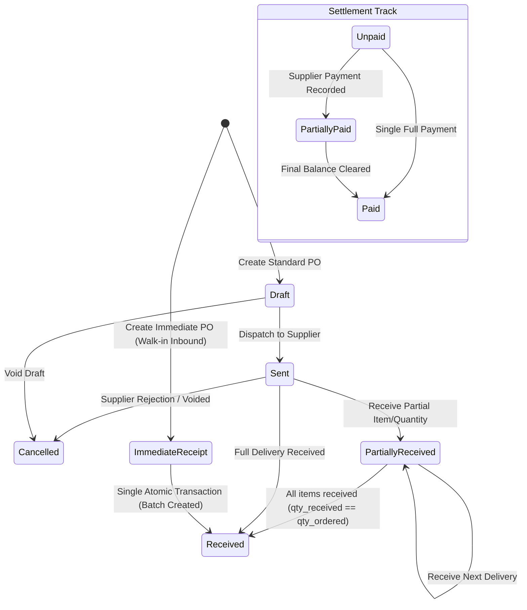

# State Machine 04: Purchase Orders & Stock Receiving Lifecycle

## 1. Domain Context & Entities
The procurement subsystem handles inventory acquisition from external vendors, transitioning through draft composition, vendor dispatch, incremental or full delivery receipt, stock batch generation, catalog price adjustments, and supplier debt settlement.

Key entities:
- **Purchase Orders**: `purchase_orders` ([`procurement.ts`](file:///Users/admin/Documents/Projects/DumosRx/client/lib/db/queries/procurement.ts))
- **Line Items**: `purchase_order_items`
- **Vendors & Payables**: `suppliers`, `supplier_payments`
- **Generated Batches**: `stock_batches`, `stock_movements` (movement_type: `'purchase'`)

---

## 2. Governing State Fields & Enums

### Order & Line Status
- `purchase_orders.status`:
  - `'pending'` / `'draft'`: Editable, no inventory impact.
  - `'sent'` / `'ordered'`: Dispatched to supplier; awaiting shipment.
  - `'partially_received'`: Some items or partial quantities received into stock.
  - `'received'`: All lines fulfilled; batches created.
  - `'cancelled'`: Voided before fulfillment; no stock impact.
- `purchase_orders.type`: `'standard'` (full multi-step workflow) vs `'immediate'` (walk-in vendor receipt; skips directly to `'received'`).
- `purchase_order_items.quantity_ordered`: Expected count.
- `purchase_order_items.quantity_received`: Cumulative count admitted into stock.
- `purchase_order_items.reprice`: Boolean flag indicating whether to update the catalog selling price (`products.selling_price`) on receipt.

### Payment Status
- `purchase_orders.payment_status`: `'unpaid'` | `'partially_paid'` | `'paid'`.
- `purchase_orders.amount_paid`, `purchase_orders.total_amount`.

---

## 3. State Transition Diagram



---

## 4. Transition Triggers & Code Paths

1. **`Draft -> Sent`**: User marks PO as dispatched in [`updatePurchaseOrderStatus()`](file:///Users/admin/Documents/Projects/DumosRx/client/lib/db/queries/procurement.ts). No inventory is created.
2. **`Sent -> PartiallyReceived / Received`**:
   - Cashier/Pharmacist opens receiving dialog and enters delivered batch numbers, expiry dates, pack quantities, and landed unit costs.
   - For each received line:
     - Increments `purchase_order_items.quantity_received`.
     - Creates new `stock_batches` row with the provided expiry date and unit cost.
     - Logs positive `stock_movements` (`movement_type = 'purchase'`).
     - If `reprice = true`, updates `products.selling_price` and logs price change history.
     - Checks if product has pending backorders/deficits; triggers auto-settlement.
   - If all lines reach `quantity_received >= quantity_ordered`, status transitions to `'received'`.
3. **`Immediate PO Creation`**:
   - Pharmacist receives direct delivery at the till.
   - In a single SQLite transaction, writes `purchase_orders` with `status = 'received'` and `type = 'immediate'`, writes line items, creates batches, and logs stock movements instantly.
4. **`Payment Transitions`**:
   - User records payments against PO in `supplier_payments`.
   - PO `amount_paid` updates. Transitions between `'unpaid'`, `'partially_paid'`, and `'paid'`.

---

## 5. Invariants & Illegal States

- **Invariant 1: No Unlinked Inbound Movements**: Every positive movement with `movement_type = 'purchase'` must reference a valid `purchase_orders.id` via `reference_id`.
- **Invariant 2: Monotonic Receiving**: `quantity_received` can only increase during receiving passes. It cannot decrease unless an explicit receipt rollback/cancellation is transacted.
- **Invariant 3: Catalog Reprice Isolation**: Repricing a product via PO receipt must NEVER mutate historical sales, existing stock batch unit costs, or closed profit margins.
- **Impossible State**: A PO with `status = 'draft'` that has rows in `stock_batches` linked to its lines.

---

## 6. Latent Edge-Case Bugs & Traps

1. **Double Receiving on Network Latency**: Receiving a large PO on slow connection can result in multiple submits if the UI does not disable the submit button upon first click. Creates duplicate batches.
2. **Backorder Auto-Settlement Timing**: If incoming stock is allocated to settle a customer backorder, the net visible quantity on the shelf must reflect the true available balance, not the raw PO invoice quantity.
3. **Voiding Received Orders**: Soft-deleting a received PO without reversing its associated `stock_movements` leaves ghost inventory on the shelves that will cause physical cycle count discrepancies.

---

## 7. Diagnostic Queries & State Verification

```sql
-- Find POs marked 'received' where items were never fully received
SELECT po.id, po.status, SUM(poi.quantity_ordered) as ordered, SUM(poi.quantity_received) as received
FROM purchase_orders po
JOIN purchase_order_items poi ON poi.purchase_order_id = po.id
WHERE po.status = 'received' AND po._deleted = 0
GROUP BY po.id
HAVING received < ordered;

-- Find POs marked 'draft' that have recorded stock movements
SELECT po.id, po.status, sm.id as movement_id, sm.quantity
FROM purchase_orders po
JOIN stock_movements sm ON sm.reference_id = po.id AND sm.reference_type = 'purchase_order'
WHERE po.status = 'draft';
```
