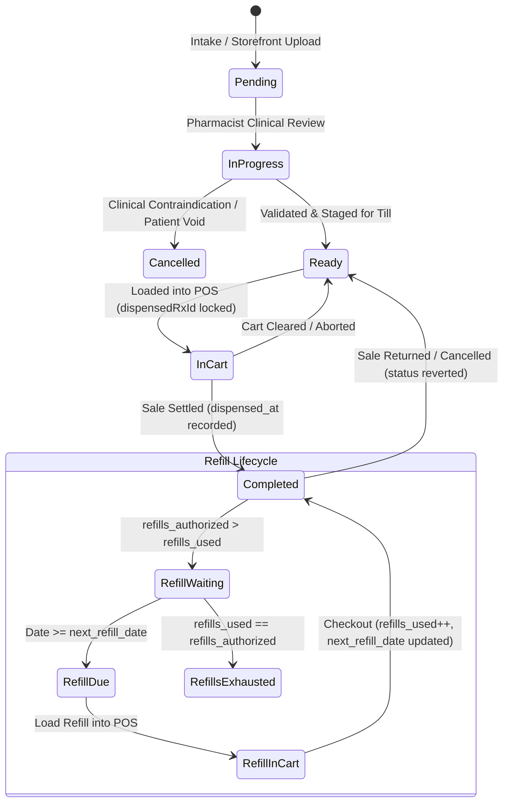

# State Machine 05: Prescription Dispense & Refill Lifecycle

## 1. Domain Context & Entities
In retail pharmacy workflows, prescription management transitions from initial medical intake/verification to staging, register dispense, and scheduled chronic refill renewals. The state machine strictly governs medication release, refills tracking, and rollback integrity upon return.

Key entities:
- **Prescription Record**: `prescriptions` ([`prescriptions.ts`](file:///Users/admin/Documents/Projects/DumosRx/client/lib/db/queries/prescriptions.ts))
- **Prescribed Items**: `prescription_items`
- **Patient/Customer**: `customers`
- **Dispensing POS Cart**: [`use-pos-cart-store.ts`](file:///Users/admin/Documents/Projects/DumosRx/client/lib/hooks/use-pos-cart-store.ts) (`dispensedRxId`)
- **Dispense Sale**: `sales`, `sale_items`

---

## 2. Governing State Fields & Columns

### Prescription Header Status
- `prescriptions.status`:
  - `'pending'`: Newly entered by staff or submitted via storefront; pending pharmacist clinical review.
  - `'in_progress'` / `'processing'`: Pharmacist validating drug interactions, dosage, or gathering stock.
  - `'ready'`: Clinical review cleared; staged for cashier dispense.
  - `'dispensed'` / `'completed'`: Medication handed over; sale settled at POS.
  - `'cancelled'`: Revoked due to dosage conflict, expired prescription, or patient refusal.
- `prescriptions.dispensed_at`: UTC timestamp of the most recent dispense or refill.

### Line-Level Refill Controls (`prescription_items`)
- `refills_authorized`: Total refills permitted by physician (0 for non-refillable).
- `refills_used`: Count of refills consumed to date.
- `refill_interval_days`: Minimum wait days between refills (e.g. 30 days).
- `next_refill_date`: Calculated earliest date for subsequent refill eligibility (`now + interval`).

---

## 3. State Transition Diagram



---

## 4. Transition Triggers & Code Paths

1. **`Pending -> InProgress -> Ready`**: Pharmacist updates clinical review status in the Prescriptions hub via [`updatePrescriptionStatus()`](file:///Users/admin/Documents/Projects/DumosRx/client/lib/db/queries/prescriptions.ts).
2. **`Ready -> InCart (Dispense Lock)`**:
   - Cashier clicks "Dispense" on a ready prescription.
   - Prescribed medications, instructions, and customer ID are injected into the POS cart store.
   - `usePosCartStore` sets `dispensedRxId = prescription.id`.
   - Cart modifications are locked to prevent accidental addition or substitution of unprescribed items.
3. **`InCart -> Completed`**:
   - Cashier collects payment and completes sale.
   - [`recordSale()`](file:///Users/admin/Documents/Projects/DumosRx/client/lib/db/queries/sales.ts) detects `dispensedRxId`.
   - Sets `prescriptions.status = 'completed'` and `dispensed_at = new Date().toISOString()`.
   - Links `sales.prescription_id`.
4. **`Chronic Refill Progression`**:
   - Customer returns for authorized refill when `next_refill_date <= today`.
   - Staff triggers refill dispense via [`dispensePrescriptionRefill()`](file:///Users/admin/Documents/Projects/DumosRx/client/lib/db/queries/prescriptions.ts).
   - Loops over valid items where `refills_authorized > refills_used`:
     - Increments `refills_used = refills_used + 1`.
     - Sets `next_refill_date = now + refill_interval_days`.
   - Updates `prescriptions.dispensed_at = now`.
5. **`Rollback on Return`**:
   - If a customer returns unopened prescription medication and the sale is refunded, the return handler reverts `prescriptions.status` back to `'ready'` or rolls back `refills_used`.

---

## 5. Invariants & Illegal States

- **Invariant 1: Refill Ceiling**: `refills_used` must NEVER exceed `refills_authorized`.
- **Invariant 2: Cart Locking**: When `dispensedRxId` is populated in POS, the cart cannot process unrelated items or arbitrary discount overrides that compromise medical audit trails.
- **Invariant 3: Dispense Timestamp Integrity**: Every prescription in `'dispensed'` or `'completed'` status must have a non-null `dispensed_at` timestamp.
- **Impossible State**: A prescription with `status = 'pending'` having an associated closed `sales` record.

---

## 6. Latent Edge-Case Bugs & Traps

1. **Refill Dispense Before First Fill**: If `dispensePrescriptionRefill()` is called on a prescription that was never originally dispensed (status still `ready`), `refills_used` increments without an initial dispense record.
2. **Multi-Till Refill Race**: Two cashiers at different registers loading the same chronic prescription at the same time can both complete checkout, causing `refills_used` to double-increment past the doctor's authorization limit.
3. **Prescription Return Orphan**: If a sale is refunded via general return without checking `sales.prescription_id`, the prescription remains in `'completed'` status while the medication has been restocked to the shelf.

---

## 7. Diagnostic Queries & State Verification

```sql
-- Find prescriptions where refills used exceeds authorized limit
SELECT p.id, p.prescription_number, pi.product_id, pi.refills_authorized, pi.refills_used
FROM prescriptions p
JOIN prescription_items pi ON pi.prescription_id = p.id
WHERE pi.refills_used > pi.refills_authorized;

-- Find completed prescriptions with missing dispense timestamps
SELECT id, prescription_number, status, dispensed_at, created_at
FROM prescriptions
WHERE status IN ('dispensed', 'completed') AND dispensed_at IS NULL;
```
