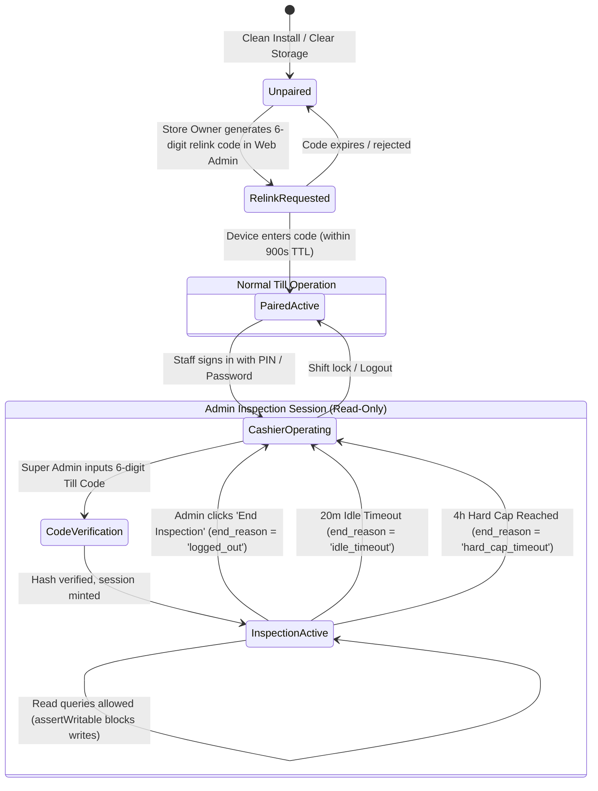

# State Machine 06: Device Linking, Relink Codes & Till Inspection Sessions

## 1. Domain Context & Entities
DumosRx runs on physical tills (desktop Tauri apps, browsers, mobile tablets) that must securely pair with a store tenant, maintain persistent device identity for sync replication tracking, and permit emergency Super Admin physical audit inspections without compromising store security or corrupting data.

Key entities:
- **Device Registration**: `user_devices` ([`user_devices_table.php`](file:///Users/admin/Documents/Projects/DumosRx/laravel-server/database/migrations/2026_10_02_000005_create_user_devices_table.php))
- **Ephemeral Relink Codes**: Redis/Cache key `till_relink:<hash>` (15-minute TTL)
- **Sanctum Tokens**: `personal_access_tokens` (scoped by `device_id`)
- **Admin Till Inspection Codes**: `admin_till_codes` ([`admin_till_tables.php`](file:///Users/admin/Documents/Projects/DumosRx/laravel-server/database/migrations/2026_10_09_000001_create_admin_till_tables.php))
- **Admin Till Sessions**: `admin_till_sessions`
- **Client Read-Only Enforcement**: [`till-inspection.ts`](file:///Users/admin/Documents/Projects/DumosRx/client/lib/utils/till-inspection.ts) (`assertWritable()`)

---

## 2. Governing State Fields & Enums

### Device Pairing & Tokens
- `user_devices.device_id`: Canonical hardware/browser UUID (e.g. `DRX-DESK-01`).
- `user_devices.device_label`: Human-readable user-agent label + optional admin nickname.
- `personal_access_tokens.device_id`: Restricts API token validity to a single paired physical device.

### Super Admin Inspection Session (`admin_till_sessions`)
- `started_at`, `expires_at`: Enforces 20-minute rolling idle window and 4-hour hard maximum cap.
- `ended_at`: Null while active; set upon session termination.
- `end_reason`:
  - `'logged_out'`: Admin explicitly ended session.
  - `'idle_timeout'`: Inactivity exceeded 20 minutes.
  - `'hard_cap_timeout'`: Total inspection elapsed time reached 4 hours.
  - `'revoked'`: Super admin code revoked remotely.

---

## 3. State Transition Diagram



---

## 4. Transition Triggers & Code Paths

1. **`Unpaired -> PairedActive (Relink Flow)`**:
   - Store Owner navigates to Store Devices in Web Admin and clicks "Generate Relink Code".
   - Server creates a cryptographically secure 6-digit code, stores `till_relink:<hash>` with a 900-second TTL.
   - Physical till enters the code. Server verifies, links `user_devices`, and mints a device-scoped Sanctum access token.
2. **`InspectionActive Initiation`**:
   - Super Admin physically arrives at a store till during an audit.
   - Types their assigned 6-digit admin code. Server validates against `admin_till_codes.code_hash`.
   - Creates row in `admin_till_sessions` with `expires_at = now + 20min`.
   - Client receives inspection token and sets in-memory flag `dumos_till_inspection = true`.
3. **`Inspection Enforcement (assertWritable)`**:
   - Every write operation in the client (`insert()`, `update()`, `softDelete()`, `foldStockQuantities()`) passes through `assertWritable()`:
     ```typescript
     if (isTillInspectionSession()) {
       throw new Error("Cannot modify records during an active admin till inspection session");
     }
     ```
   - Automatically prevents auto-heal or cashier transactions from running in the background.
4. **`Session Termination`**:
   - Admin clicks "Exit Inspection", or client detects rolling idle timeout (20 mins) or hard ceiling (4 hours).
   - Server marks `ended_at = NOW()` and logs `end_reason`.
   - Client clears `dumos_till_inspection` and restores normal cashier mode.

---

## 5. Invariants & Illegal States

- **Invariant 1: Absolute Read-Only in Inspection**: While `dumos_till_inspection` is active, NO database mutations can occur on the physical till. Background sync pushes and stock auto-healing are suppressed.
- **Invariant 2: Single-Use Relink Codes**: Relink codes are purged from cache immediately upon first successful consumption.
- **Invariant 3: Hard Ceiling Cap**: An inspection session cannot be extended indefinitely by continuous activity; after 4 hours, termination is mandatory.
- **Impossible State**: An `admin_till_sessions` row with a non-null `ended_at` but a null `end_reason`.

---

## 6. Latent Edge-Case Bugs & Traps

1. **Stale Inspection Flag Across App Restarts**: If the client stores `dumos_till_inspection` in persistent `localStorage` rather than session storage, a crash during inspection permanently freezes the till in read-only mode.
2. **Token Device Mismatch**: If an API request carries an access token whose stored `device_id` disagrees with the `X-Device-Id` HTTP header, requests must be rejected to prevent token stealing.
3. **Bare Device ID Presentation**: Presenting bare `DRX-` IDs in UI/logs without resolving against `user_devices.device_label` and `device_nicknames` violates Rule 6 and causes operator confusion during audit reviews.

---

## 7. Diagnostic Queries & State Verification

```sql
-- Find active admin till sessions that have exceeded their hard cap or expiration
SELECT id, admin_id, store_id, device_id, started_at, expires_at, ended_at
FROM admin_till_sessions
WHERE ended_at IS NULL AND (expires_at < NOW() OR TIMESTAMPDIFF(HOUR, started_at, NOW()) > 4);

-- Audit expired or revoked till codes
SELECT id, admin_id, label, last_used_at, revoked_at
FROM admin_till_codes
WHERE revoked_at IS NOT NULL;
```
