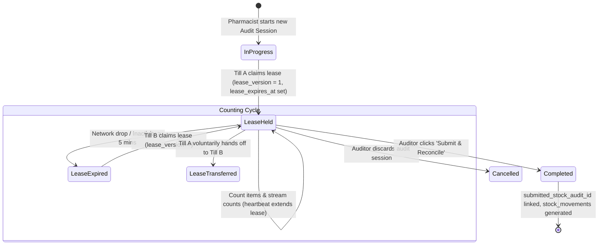

# State Machine 07: Multi-Till Stock Audit & Distributed Lease Sessions

## 1. Domain Context & Entities
Stock cycle counts and physical inventory audits in pharmacies often span multiple tills and handheld scanners across aisles. To avoid count clobbering while allowing collaborative auditing, DumosRx employs a distributed lease protocol over audit sessions.

Key entities:
- **Cloud Audit Sessions**: `audit_sessions` ([`create_audit_sessions_table.php`](file:///Users/admin/Documents/Projects/DumosRx/laravel-server/database/migrations/2026_11_03_000001_create_audit_sessions_table.php))
- **Audit Items**: `audit_session_items`
- **Local Client Drafts**: `stock_audit_drafts` ([`stock-audit-drafts.ts`](file:///Users/admin/Documents/Projects/DumosRx/client/lib/db/queries/stock-audit-drafts.ts))
- **Reconciled Audits**: `stock_audits`

---

## 2. Governing State Fields & Lease Controls

### Session Status & Distributed Lease (`audit_sessions`)
- `status`: `'in_progress'` | `'completed'` | `'cancelled'`.
- `active_till_id`: UUID of the till currently holding the exclusive counting lock.
- `active_user_id`: Pharmacist or auditor who claimed the lease.
- `lease_version`: Monotonically increasing counter incremented on every lease claim or transfer.
- `lease_expires_at`: UTC timestamp of lease expiry (short rolling heartbeat, e.g. 5 minutes).
- `submitted_stock_audit_id`: Pointer to the final reconciled `stock_audits` batch upon completion.

### Local Audit Status (`stock_audits`)
- `status`: `'pending'` (variance calculated, pending manager sign-off) | `'reconciled'` (stock movements written).

---

## 3. State Transition Diagram



---

## 4. Transition Triggers & Code Paths

1. **`Session Initialization`**:
   - Store manager initiates an audit across the store or a category.
   - Server writes `audit_sessions` in `'in_progress'` status.
2. **`Lease Acquisition & Heartbeat`**:
   - A till opens the session. If `active_till_id` is null or `lease_expires_at < NOW()`, the till issues a claim request.
   - Server sets `active_till_id = device_id`, increments `lease_version`, and sets `lease_expires_at = NOW() + 5 minutes`.
   - While counting, periodic heartbeats every 60 seconds extend `lease_expires_at`.
3. **`Lease Conflict & Stealing`**:
   - If Till A loses power or wifi, its lease expires.
   - Till B can take over the count by issuing a claim; server bumps `lease_version`.
   - If Till A comes back online and attempts to post counts with the old `lease_version`, the server rejects with HTTP 409 Conflict.
4. **`Submission & Stock Reconciliation`**:
   - Once all aisles are counted, the active till submits the session.
   - Status transitions to `'completed'`.
   - For every discrepancy (`actual_quantity != expected_quantity`):
     - Calculates cost and selling price differences.
     - Creates `stock_audits` row.
     - Generates `stock_movements` with `movement_type = 'adjustment'`.
     - Updates `stock_batches.quantity` via `recomputeBatchQuantities()`.

---

## 5. Invariants & Illegal States

- **Invariant 1: Monotonic Lease Versions**: A count item batch submitted with `lease_version < current_lease_version` must NEVER be written. This prevents split-brain count clobbering.
- **Invariant 2: Exclusive Active Till**: No two tills can hold a valid unexpired lease concurrently for the same session.
- **Invariant 3: Single Final Submission**: Once an audit session transitions to `'completed'`, its counts are immutable and `submitted_stock_audit_id` cannot be overwritten.
- **Impossible State**: An audit session marked `'completed'` with `completed_at IS NULL`.

---

## 6. Latent Edge-Case Bugs & Traps

1. **Stale Local Draft Overwrite**: If Till A counts offline without holding a valid server lease, reconnecting can overwrite items counted by Till B if the client blindly syncs local `stock_audit_drafts`.
2. **Mid-Audit Sales Stock Drift**: If sales continue while an audit is in progress, `expected_quantity` changes between the start of the count and final submission. System must snapshot expected stock at count start or calculate delta adjustments.
3. **Ghost Batches in Discrepancies**: If an auditor counts physical items of a product that has no batch registered, reconciling must create a target batch with prefix `AUDIT` rather than failing foreign key constraints.

---

## 7. Diagnostic Queries & State Verification

```sql
-- Find audit sessions with expired leases that are still marked in_progress
SELECT id, store_id, name, active_till_id, lease_version, lease_expires_at
FROM audit_sessions
WHERE status = 'in_progress' AND lease_expires_at < NOW();

-- Find completed audit sessions lacking reconciled audit IDs
SELECT id, store_id, name, completed_at, submitted_stock_audit_id
FROM audit_sessions
WHERE status = 'completed' AND submitted_stock_audit_id IS NULL;
```

