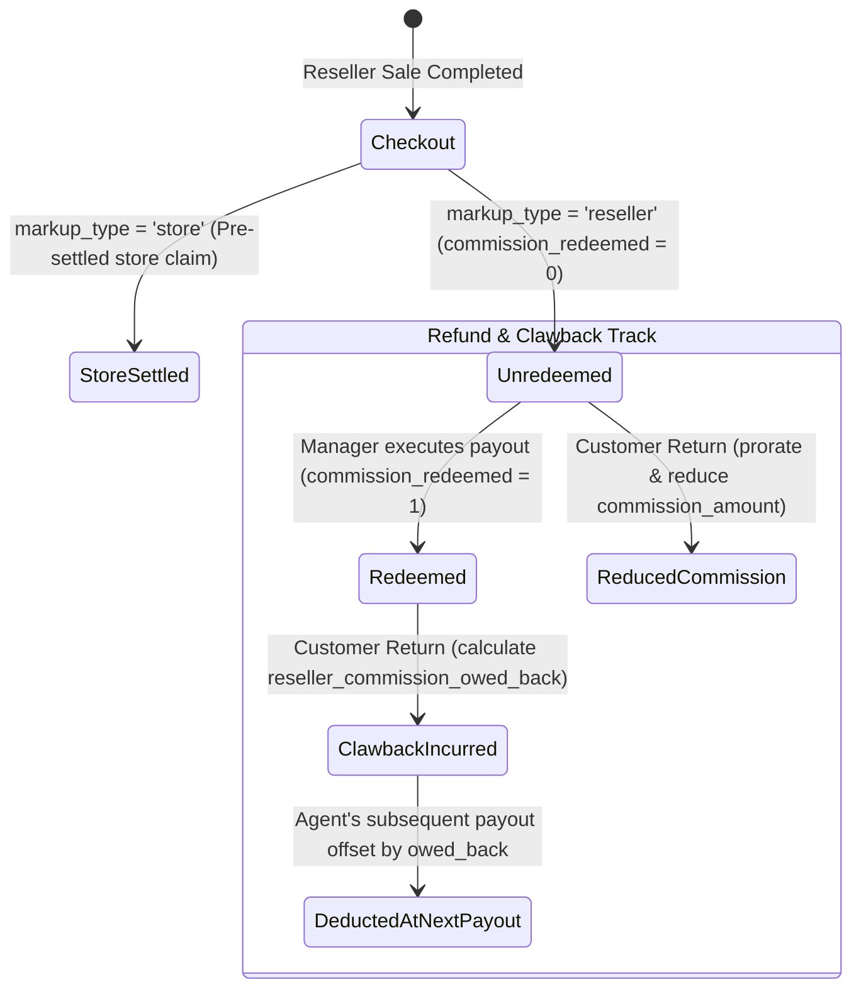

# State Machine 08: Reseller Commissions, Markups & Payout Clawbacks

## 1. Domain Context & Entities
Pharmacies frequently partner with external sales agents, medical representatives, and referring doctors who bring patients or resell inventory at custom markups. DumosRx tracks whether markups belong to the pharmacy or the reseller, manages redemption payouts, and handles commission clawbacks when sales are refunded.

Key entities:
- **Reseller Sales**: `sales` ([`2026_09_16_000000_add_reseller_commission_columns.php`](file:///Users/admin/Documents/Projects/DumosRx/laravel-server/database/migrations/2026_09_16_000000_add_reseller_commission_columns.php))
- **Held Transactions**: `held_transactions` (stores reseller agent and markup mode while cart is parked)
- **Sale Returns**: `returns`, `return_items` ([`returns.ts`](file:///Users/admin/Documents/Projects/DumosRx/client/lib/db/queries/returns.ts))

---

## 2. Governing State Fields & Enums

### Markup Strategy & Attribution (`sales`)
- `is_reseller_sale`: `1` (agent-linked sale) | `0` (standard retail sale).
- `markup_type`:
  - `'store'`: Markup above catalog base price is retained by the store. Pre-settled at checkout (`store_claim`). No debt owed to agent.
  - `'reseller'`: Markup represents commission owed to the external agent.
- `reseller_agent_id`: Identifier of the agent earning commission.

### Commission Lifecycle Columns
- `reseller_commission_amount`: Total commission generated by the sale.
- `reseller_commission_redeemed`: `0` (unclaimed / payable) | `1` (paid out).
- `reseller_commission_redeemed_amount`: Exact monetary amount paid out to the agent.
- `reseller_commission_owed_back`: Prorated clawback debt incurred if a sale is refunded after commission has already been paid out.

---

## 3. State Transition Diagram



---

## 4. Transition Triggers & Code Paths

1. **`Checkout Attribution`**:
   - Cashier checks "Reseller Sale", selects agent, and configures markup in POS.
   - If `markup_type == 'store'`:
     - Full proceeds enter store revenue; commission marked pre-settled.
   - If `markup_type == 'reseller'`:
     - Commission is calculated as `SUM(item.quantity * item.reseller_markup)`.
     - Saved with `reseller_commission_redeemed = 0` and `reseller_commission_owed_back = 0`.
2. **`Commission Payout`**:
   - Store manager reviews pending agent balances in the Resellers hub.
   - Executes payout (cash from till or bank transfer).
   - Updates target sales to `reseller_commission_redeemed = 1` and `reseller_commission_redeemed_amount = reseller_commission_amount`.
3. **`Refund on Unredeemed Sale`**:
   - Customer returns items before the agent has been paid.
   - [`restoreReturnedStock()`](file:///Users/admin/Documents/Projects/DumosRx/client/lib/db/queries/returns.ts) recalculates the prorated commission for returned items and reduces `reseller_commission_amount`.
   - No clawback debt is incurred because no cash was disbursed.
4. **`Refund on Already-Redeemed Sale (Clawback)`**:
   - Customer returns items after the agent was already paid out.
   - The pharmacy cannot retract cash already handed to the agent.
   - System calculates prorated commission:
     $$\text{clawback} = \text{redeemed\_amount} \times \left(\frac{\text{returned\_quantity}}{\text{total\_sold\_quantity}}\right)$$
   - Writes `reseller_commission_owed_back = reseller_commission_owed_back + clawback`.
   - On the agent's next settlement, the owed-back balance is subtracted from new earnings.

---

## 5. Invariants & Illegal States

- **Invariant 1: No Clawback on Unredeemed Sales**: `reseller_commission_owed_back` must remain `0` if `reseller_commission_redeemed == 0`.
- **Invariant 2: Store Markup Immunity**: Sales with `markup_type = 'store'` must NEVER accrue payable agent commissions or clawback balances.
- **Invariant 3: Clawback Ceiling**: Total `reseller_commission_owed_back` on a sale cannot exceed `reseller_commission_redeemed_amount`.
- **Impossible State**: A sale where `reseller_commission_redeemed == 0` but `reseller_commission_redeemed_amount > 0`.

---

## 6. Latent Edge-Case Bugs & Traps

1. **Held Transaction Markup Type Loss**: If a cashier parks a cart with reseller markup and recalls it, failure to serialize `markup_type` causes the sale to default to standard retail, losing the agent's commission.
2. **Rounding Drift on Prorated Returns**: On fractional returns of multi-item bundles, floating-point divisions can leave fractional cents in `owed_back`. System must enforce `roundMoney()`.
3. **Agent Balance Underflow**: When deducting `owed_back` from future payouts, if the agent never returns or makes new sales, the store carries an uncollected receivable that must be surfaced as bad debt.

---

## 7. Diagnostic Queries & State Verification

```sql
-- Find sales with impossible commission states (redeemed amount on unredeemed sale)
SELECT id, receipt_number, reseller_agent_id, reseller_commission_amount, reseller_commission_redeemed, reseller_commission_redeemed_amount
FROM sales
WHERE reseller_commission_redeemed = 0 AND reseller_commission_redeemed_amount > 0;

-- Audit pending clawbacks across agents
SELECT reseller_agent_id, SUM(reseller_commission_owed_back) as total_owed_back
FROM sales
WHERE is_reseller_sale = 1 AND reseller_commission_owed_back > 0
GROUP BY reseller_agent_id;
```
