# State Machine 09: Customer Credit, Balances & Debt Settlement

## 1. Domain Context & Entities
Pharmacies routinely offer credit accounts for trusted patients, recurring chronic therapy, or corporate billing. DumosRx tracks individual credit ceilings, updates running receivables, prevents unauthorized credit overruns, and manages credit restoration when sales are refunded.

Key entities:
- **Customer Account**: `customers` ([`customers.ts`](file:///Users/admin/Documents/Projects/DumosRx/client/lib/db/queries/customers.ts))
- **Credit Sales & Tender Splits**: `sales` ([`sales.ts`](file:///Users/admin/Documents/Projects/DumosRx/client/lib/db/queries/sales.ts))
- **Debt Repayments**: `customer_payments` ([`2026_09_05_000001_create_customer_payments_table.php`](file:///Users/admin/Documents/Projects/DumosRx/laravel-server/database/migrations/2026_09_05_000001_create_customer_payments_table.php))
- **Returns & Reversals**: `returns` ([`returns.ts`](file:///Users/admin/Documents/Projects/DumosRx/client/lib/db/queries/returns.ts))

---

## 2. Governing State Fields & Thresholds

### Customer Debt Controls (`customers`)
- `outstanding_balance`: Current debt owed to the pharmacy.
- `credit_limit`: Maximum allowable credit ceiling.

### Transaction Attributes (`sales` & `customer_payments`)
- `sales.payment_method`: `'credit'` or `'split'` containing credit tenders.
- `sales.payment_details`: JSON object recording the exact credit amount applied.
- `customer_payments.amount`: Debt repayment amount.
- `customer_payments.payment_method`: Tender used to settle debt (`'cash'`, `'card'`, `'transfer'`).

---

## 3. State Transition Diagram

```mermaid
stateDiagram-v2
    [*] --> ZeroDebt: Customer with outstanding_balance = 0
    ZeroDebt --> InDebt: Credit Sale processed (outstanding_balance += amount)
    InDebt --> InDebt: Additional Credit Sale (within credit_limit)
    InDebt --> OverLimitBlocked: Attempted sale where (balance + amount > credit_limit)
    OverLimitBlocked --> InDebt: Payment recorded or limit raised
    
    InDebt --> PartiallySettled: Customer makes partial payment
    PartiallySettled --> InDebt: Additional Credit Sale
    PartiallySettled --> ZeroDebt: Full Balance Paid (outstanding_balance = 0)
    
    state "Refund Handling" as Refund {
        InDebt --> DebtReduced: Refund on Credit Sale (balance credited; no cash disbursed)
        ZeroDebt --> StoreCreditDeposit: Refund on previously settled credit sale
    }
```



---

## 4. Transition Triggers & Code Paths

1. **`Credit Authorization & Sale Commit`**:
   - Cashier selects "Credit" tender in POS.
   - System checks:
     $$\text{current\_balance} + \text{credit\_amount} \le \text{credit\_limit}$$
   - If exceeded, checkout is blocked until an authorized manager overrides or customer pays cash.
   - Upon commit in [`recordSale()`](file:///Users/admin/Documents/Projects/DumosRx/client/lib/db/queries/sales.ts):
     - Inserts `sales` with payment method `'credit'`.
     - Updates `customers SET outstanding_balance = outstanding_balance + credit_amount`.
2. **`Debt Repayment`**:
   - Customer visits pharmacy to settle account.
   - Cashier records receipt in Customer Balances hub.
   - Inserts row into `customer_payments`.
   - Decrements `customers.outstanding_balance`.
   - Money enters cash drawer / bank account.
3. **`Refund of Credit Transactions`**:
   - Customer returns goods bought on credit.
   - Return handler checks `sales.payment_method` and `payment_details`.
   - **Critical Rule**: Cash is NEVER disbursed from the till for an unpaid credit sale.
   - The returned amount is deducted directly from `customers.outstanding_balance`.
   - If the customer had already paid off the credit balance via `customer_payments`, the refund can be disbursed in cash or recorded as advance store credit.

---

## 5. Invariants & Illegal States

- **Invariant 1: Cash Drawer Protection on Credit Returns**: Refunding a sale originally transacted on credit must credit the customer's ledger rather than depleting physical cash drawer float.
- **Invariant 2: Non-Negative Running Balance Warning**: While overpayments can result in a negative `outstanding_balance` (store credit), arbitrary negative balances without matching `customer_payments` represent data anomalies.
- **Invariant 3: Split Tender Precision**: When a sale is split between cash and credit, only the credit component increases `outstanding_balance`.
- **Impossible State**: A customer with `outstanding_balance > credit_limit` created by an unprivileged cashier checkout without manager override.

---

## 6. Latent Edge-Case Bugs & Traps

1. **Split-Brain Concurrent Credit Checkout**: If two registers checkout the same credit customer simultaneously while offline, each till calculates `balance + amount <= limit` independently, resulting in credit limit violations upon sync.
2. **Ledger Disagreement**: If a customer's `outstanding_balance` is computed via cached column rather than derived from `SUM(credit_sales) - SUM(customer_payments) + SUM(credit_returns)`, sync conflicts can cause the cached balance to drift.
3. **Double Debt Deductions on Partial Returns**: Refunding part of a multi-tender sale (e.g. 50% cash, 50% credit) without checking which specific lines were paid by credit can over-credit the customer's balance.

---

## 7. Diagnostic Queries & State Verification

```sql
-- Find customers whose cached balance disagrees with transaction history
SELECT c.id, c.name, c.outstanding_balance AS cached_balance,
       (COALESCE(sales_total.credit_sum, 0) - COALESCE(payments_total.paid_sum, 0)) AS calculated_balance
FROM customers c
LEFT JOIN (
    SELECT customer_id, SUM(total_amount) as credit_sum 
    FROM sales 
    WHERE payment_method = 'credit' AND _deleted = 0 
    GROUP BY customer_id
) sales_total ON sales_total.customer_id = c.id
LEFT JOIN (
    SELECT customer_id, SUM(amount) as paid_sum 
    FROM customer_payments 
    WHERE _deleted = 0 
    GROUP BY customer_id
) payments_total ON payments_total.customer_id = c.id
WHERE ABS(c.outstanding_balance - (COALESCE(sales_total.credit_sum, 0) - COALESCE(payments_total.paid_sum, 0))) > 0.01;
```
