# State Machine 10: Store Fleet, Subscriptions & Offline License Tokens

## 1. Domain Context & Entities
DumosRx manages multi-tenant pharmacy fleets through cloud subscriptions, web admin tenant controls, and cryptographically verified offline JWT license tokens that protect software integrity when tills are offline for extended periods.

Key entities:
- **Tenant Store**: `stores` ([`2026_01_22_100000_create_stores_table.php`](file:///Users/admin/Documents/Projects/DumosRx/laravel-server/database/migrations/2026_01_22_100000_create_stores_table.php))
- **Billing Subscriptions**: `subscriptions`
- **Offline License Engine**: `LicenseGuard` (client offline JWT validator)
- **Store Sync Gate**: [`store-refusal.ts`](file:///Users/admin/Documents/Projects/DumosRx/client/lib/db/sync-engine/store-refusal.ts)
- **Token Manager**: `personal_access_tokens`

---

## 2. Governing State Fields & Enums

### Store Fleet Lifecycle (`stores`)
- `status`: `'Active'` | `'Suspended'` (manual freeze by platform admin or payment failure).
- `deleted_at`: Soft-deleted timestamp (marks tenant as `'Archived'`).
- `is_demo`: `1` (sandbox store) | `0` (live customer).
- `license_token`: Signed offline RS256/HS256 JWT string containing plan features, max tills, and expiry timestamp.

### Subscription Status (`subscriptions`)
- `status`: `'trial'` | `'active'` | `'grace_period'` | `'expired'` | `'cancelled'`.

### Client License Verification States (`LicenseGuard`)
- **`VALID`**: Token signature valid, not expired, system clock authentic.
- **`EXPIRED`**: Token validity date has passed; entering grace period.
- **`CLOCK_TAMPERED`**: Client system wall-clock detected moving backwards behind high-watermark timestamp.
- **`DEVICE_REVOKED`**: Device ID or store blacklisted by central server.

---

## 3. State Transition Diagram

```mermaid
stateDiagram-v2
    [*] --> Trial: Store Sign Up
    Trial --> Active: Subscription Paid (Paystack / Flutterwave)
    Trial --> GracePeriod: Trial ends without payment
    Active --> GracePeriod: Renewal charge fails
    GracePeriod --> Active: Payment recovered
    GracePeriod --> Expired: Grace period expires (14 days)
    
    Active --> Suspended: Platform Admin manual suspension
    Suspended --> Active: Admin unsuspends store
    
    Expired --> Archived: Admin Archives Store (tokens revoked, deleted_at set)
    Suspended --> Archived: Admin Archives Store
    Archived --> Purged: Super Admin hard-purges tenant and all data
    
    state "Offline Client License Verification" as OfflineCheck {
        ValidToken --> ClockTampered: System clock rolled back > watermark
        ValidToken --> ExpiredToken: Expiration date reached
        ClockTampered --> Lockout: POS functions locked; contact support
    }
```



---

## 4. Transition Triggers & Code Paths

1. **`Subscription Activation`**:
   - Webhook from Paystack verifies payment.
   - `SubscriptionController::activateSubscriptionFromTransaction()` sets `subscriptions.status = 'active'`.
   - Issues fresh cryptographically signed `license_token` to `stores.license_token`.
2. **`Client Offline Verification & Anti-Backdating`**:
   - Client boot calls `LicenseGuard.verify()`:
     - Checks cryptographic signature and payload dates.
     - Compares `current_time` against stored watermark `last_recorded_operation_timestamp`.
     - **Anti-Tampering Guard**: If `current_time < watermark - 1 hour`, the user rolled back the computer clock to evade license expiration. Triggers `CLOCK_TAMPERED` lockout.
3. **`Suspension & Sync Refusal`**:
   - Platform admin clicks "Suspend Store" in Super Admin dashboard.
   - Sets `stores.status = 'Suspended'`.
   - Next sync attempt by any store till is intercepted by [`SyncController.php`](file:///Users/admin/Documents/Projects/DumosRx/laravel-server/app/Http/Controllers/Api/SyncController.php).
   - Server returns HTTP 403 with refusal payload.
   - Client [`handleStoreRefusal()`](file:///Users/admin/Documents/Projects/DumosRx/client/lib/db/sync-engine/store-refusal.ts) halts all push/pull queues and surfaces notification.
4. **`Store Archival & Token Revocation`**:
   - Setting `deleted_at` on `stores` triggers token sweeper.
   - Revokes all `personal_access_tokens` linked to that store to prevent stale headless clients from hitting APIs.

---

## 5. Invariants & Illegal States

- **Invariant 1: Anti-Backdating Preservation**: The client anti-tampering clock guard must NEVER be bypassed (Rule 8).
- **Invariant 2: Sync Refusal on Inactive Tenants**: A store in `'Suspended'` or `'Archived'` status must NEVER be allowed to sync new sales or download product catalogs.
- **Invariant 3: Cascade Archival**: Archiving a store immediately suspends all of its child devices and staff access tokens.
- **Impossible State**: A store marked `deleted_at IS NOT NULL` with active, unrevoked personal access tokens.

---

## 6. Latent Edge-Case Bugs & Traps

1. **CMOS Battery Failure False Positive**: If an old desktop's motherboard battery dies, its clock may reset to 1970 upon boot, triggering `CLOCK_TAMPERED` lock even for legitimate subscribers.
2. **Offline Grace Period Disagreement**: If the server grants a 7-day grace extension online, an offline till cannot know this until it reconnects. The client license token must embed a built-in offline grace buffer.
3. **JWT Expiry without Notification**: If a token expires during peak business hours, registers suddenly lock mid-transaction unless the client warns cashiers 72 hours in advance.

---

## 7. Diagnostic Queries & State Verification

```sql
-- Find active personal access tokens belonging to archived stores
SELECT pat.id, pat.name, pat.tokenable_id, s.id as store_id, s.deleted_at
FROM personal_access_tokens pat
JOIN users u ON u.id = pat.tokenable_id
JOIN stores s ON s.id = u.store_id
WHERE s.deleted_at IS NOT NULL;

-- Find stores in suspended status with active subscriptions
SELECT s.id, s.name, s.status, sub.status as subscription_status, sub.ends_at
FROM stores s
JOIN subscriptions sub ON sub.store_id = s.id
WHERE s.status = 'Suspended' AND sub.status = 'active';
```

