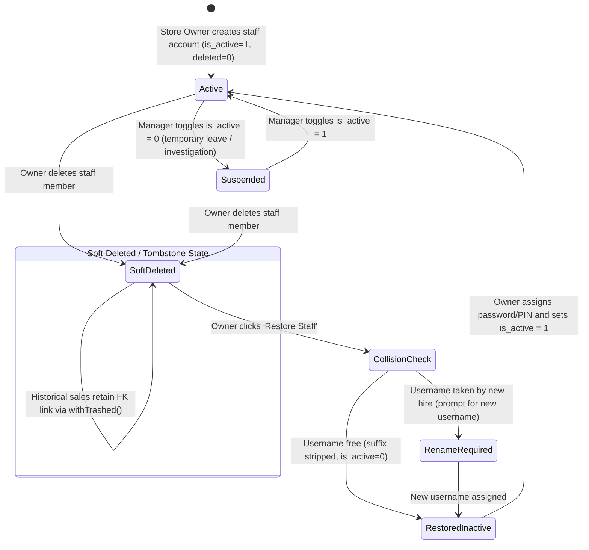

# State Machine 11: Staff Accounts, Credential Mutilation & Sync Tombstones

## 1. Domain Context & Entities
Managing staff lifecycle in DumosRx balances immediate operational security (revoking cashier till access upon termination) with immutable regulatory audit trails (sales, dispense records, and till logs must retain attribution to the staff member who performed them).

Key entities:
- **Staff Accounts**: `users` ([`0001_01_01_000000_create_users_table.php`](file:///Users/admin/Documents/Projects/DumosRx/laravel-server/database/migrations/0001_01_01_000000_create_users_table.php))
- **Roles & Permissions**: `roles`, `permission_groups`, `permission_user`
- **Sync Attribution**: `SyncOwnershipResolver.php` (resolves historical actors using `withTrashed()`)
- **Staff Deletion Manager**: [`use-staff-management.ts`](file:///Users/admin/Documents/Projects/DumosRx/client/lib/hooks/use-staff-management.ts)

---

## 2. Governing State Fields & Tombstone Flags

### Account State Columns
- `is_active`: `1` (permitted to log in at till/web) | `0` (suspended/deactivated).
- `_deleted` (SQLite) / `deleted_at` (MySQL): Soft-delete indicator.
- `username`, `email`: Unique per tenant store.
- **Credential Mutilation Pattern**:
  - Deleted accounts have their credentials suffixed: `username_del_<timestamp>` and `email_del_<timestamp>`.
  - Releases the original username and email for reuse by future hires.

---

## 3. State Transition Diagram



---

## 4. Transition Triggers & Code Paths

1. **`Active -> Suspended (Temporary Inactivation)`**:
   - Manager flips "Active" switch in Staff settings.
   - Sets `is_active = 0`.
   - Till rejects subsequent PIN/password login attempts, but historical username and permissions are preserved untouched.
2. **`Active/Suspended -> SoftDeleted (Credential Mutilation)`**:
   - Store Owner deletes staff member from the roster.
   - To prevent unique index collisions while allowing another employee to be hired with the same name, system mutates the credentials:
     ```typescript
     const timestamp = Date.now();
     const mutilatedUsername = `${user.username}_del_${timestamp}`;
     const mutilatedEmail = user.email ? `${user.email}_del_${timestamp}` : null;
     ```
   - Sets `_deleted = 1`, `is_active = 0`, revokes all active sessions.
   - Preserves row so that historical sales (`sales.user_id`) remain intact.
3. **`Historical Sync Resolution`**:
   - When offline sync pushes sales or audit logs performed by a former employee, `SyncOwnershipResolver` queries `User::withTrashed()`.
   - Prevents foreign key constraint rejections during cloud sync.
4. **`Restoration & Suffix Stripping`**:
   - Owner views "Deleted Staff" tab and clicks "Restore".
   - System strips `_del_<timestamp>`.
   - Checks if the original username was claimed by a new staff member in the interim:
     - If free: restores original username.
     - If taken: prompts owner for a replacement username.
   - Sets `_deleted = 0` and `is_active = 0` (security guard: restored users are never active by default; manager must set a fresh PIN/password).

---

## 5. Invariants & Illegal States

- **Invariant 1: Historical Attribution Immutability**: Staff account rows must NEVER be hard-deleted (`DELETE FROM users`). Doing so corrupts sales audit trails and financial reports.
- **Invariant 2: Restored Accounts Must Be Inactive by Default**: A restored account must be set to `is_active = 0` to prevent unauthorized access with stale forgotten credentials.
- **Invariant 3: Mutilation Uniqueness**: Appended timestamps must use millisecond precision to guarantee uniqueness during batch deletions.
- **Impossible State**: A user with `_deleted = 1` and `is_active = 1`.

---

## 6. Latent Edge-Case Bugs & Traps

1. **Unchecked Username Clashes on Restore**: Stripping `_del_<timestamp>` without checking the current active roster leads to SQLite unique constraint crashes during restoration.
2. **Sync Tombstone Overwrite**: If a device goes offline before receiving the soft-delete push and later updates the user record locally, conflicting versions must recognize tombstoned status and prevent resurrecting deleted accounts.
3. **Deleted User in Active Till Drawer**: If a cashier is deleted mid-shift while their till drawer session is open, closing the shift can fail if queries assume the user is active.

---

## 7. Diagnostic Queries & State Verification

```sql
-- Find soft-deleted users that are illegally marked active
SELECT id, username, email, is_active, _deleted
FROM users
WHERE _deleted = 1 AND is_active = 1;

-- Find orphaned sales referencing non-existent staff IDs
SELECT s.id as sale_id, s.user_id, s.created_at
FROM sales s
LEFT JOIN users u ON u.id = s.user_id
WHERE u.id IS NULL;
```
