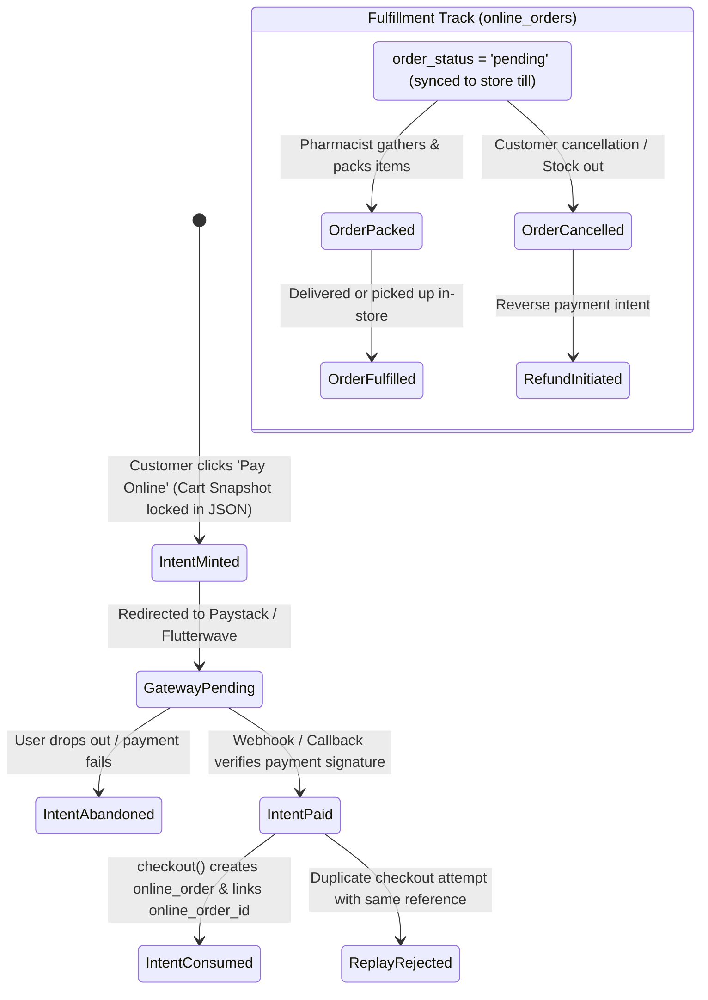

# State Machine 12: Storefront Orders & Payment Intent Verification

## 1. Domain Context & Entities
DumosRx provides white-label e-commerce storefronts for pharmacies, allowing patients to order medications online, upload prescriptions, and pay via payment gateways (Paystack/Flutterwave) or cash-on-delivery. The state machine secures payment authorization against replay attacks, enforces cart immutability, and drives fulfillment.

Key entities:
- **Payment Intents**: `storefront_payment_intents` ([`create_storefront_payment_intents_table.php`](file:///Users/admin/Documents/Projects/DumosRx/laravel-server/database/migrations/2026_09_24_000000_create_storefront_payment_intents_table.php))
- **Online Orders & Lines**: `online_orders`, `online_order_items` ([`create_online_orders_table.php`](file:///Users/admin/Documents/Projects/DumosRx/laravel-server/database/migrations/2026_07_05_171215_create_online_orders_table.php))
- **Storefront Config & Prescriptions**: `storefronts`, `storefront_prescriptions`
- **Controller Enforcement**: `StorefrontController.php`

---

## 2. Governing State Fields & Enums

### Payment Intent Verification (`storefront_payment_intents`)
- `status`:
  - `'pending'`: Intent minted; checkout URL handed to customer.
  - `'paid'`: Gateway confirmed transaction success; awaiting cart consumption.
  - `'consumed'`: Order instantiated; reference locked against replay.
  - `'refunded'`: Payment reversed.
  - `'abandoned'`: Customer failed to complete within TTL window.
- `items`: Immutable JSON snapshot of cart lines minted with the reference.
- `consumed_at`: Timestamp when the intent converted into an active `online_order`.

### Online Order Fulfillment (`online_orders`)
- `payment_status`: `'pending'` | `'paid'` | `'failed'` | `'refunded'`.
- `order_status`: `'pending'` | `'packed'` | `'fulfilled'` | `'cancelled'`.
- `payment_method`: `'paystack'` | `'transfer'` | `'in_store'`.

---

## 3. State Transition Diagram



---

## 4. Transition Triggers & Code Paths

1. **`IntentMinted (Cart Locking)`**:
   - Before handing the customer a gateway checkout URL, the server generates a cryptographically random reference.
   - Saves row in `storefront_payment_intents` with `status = 'pending'` and serializes the exact cart snapshot (`product_id`, `quantity`, `unit_price`, `subtotal`).
   - Guarantees that the reference cannot be replayed for a different cart or manipulated pricing.
2. **`IntentPaid -> IntentConsumed`**:
   - Customer completes gateway transaction.
   - Provider calls backend webhook; verifies cryptographic signature and marks intent `status = 'paid'`.
   - `StorefrontController::checkout()` runs inside a database transaction:
     - Validates that the submitted items match `items` JSON snapshot exactly.
     - Confirms intent `status == 'paid'` and `consumed_at IS NULL`.
     - Sets intent `status = 'consumed'`, `consumed_at = NOW()`.
     - Creates `online_orders` and `online_order_items` with `payment_status = 'paid'` and `order_status = 'pending'`.
3. **`Till Notification & Fulfillment`**:
   - Local store till sync engine pulls new `online_orders`.
   - Cashier interface triggers audible alert.
   - Pharmacist packs items (`order_status = 'packed'`).
   - Upon customer pickup or rider dispatch, order transitions to `'fulfilled'`.

---

## 5. Invariants & Illegal States

- **Invariant 1: Reference Replay Immunity**: A payment reference may be consumed into an `online_order` exactly once. Any second call with the same reference is rejected with HTTP 409.
- **Invariant 2: Cart Price Tampering Guard**: The items fulfilled in `online_orders` must match the pricing and product set locked into the payment intent's `items` column.
- **Invariant 3: Subscription Isolation**: Storefront charges must NEVER land in `payment_transactions`. Keeping them isolated in `storefront_payment_intents` guarantees storefront payments never trigger subscription plans.
- **Impossible State**: An `online_order` referencing a payment intent where `status != 'consumed'`.

---

## 6. Latent Edge-Case Bugs & Traps

1. **Race Between Webhook and Client Redirect**: If the customer's browser redirects to `checkout()` before the Paystack webhook arrives, the intent may still be in `'pending'` status. The checkout controller must verify status directly against the gateway API if the webhook is pending.
2. **Double Inventory Depletion on In-Store Pickup**: When an online order is picked up and settled at the register, ringing it up as a fresh POS sale can cause inventory to be deducted a second time if not explicitly linked to the online order ID.
3. **Price Drift During Extended Checkout**: If catalog prices change while a customer lingers on the gateway screen, the system must respect the locked intent price snapshot rather than recalculating current shelf prices upon callback.

---

## 7. Diagnostic Queries & State Verification

```sql
-- Find consumed intents without linked online orders (orphans)
SELECT id, reference, amount, status, consumed_at, online_order_id
FROM storefront_payment_intents
WHERE status = 'consumed' AND online_order_id IS NULL;

-- Find online orders marked paid without matching consumed intents
SELECT oo.id, oo.total_amount, oo.paystack_reference, oo.payment_status
FROM online_orders oo
LEFT JOIN storefront_payment_intents spi ON spi.reference = oo.paystack_reference
WHERE oo.payment_method = 'paystack' AND oo.payment_status = 'paid' AND (spi.id IS NULL OR spi.status != 'consumed');
```
